# The Switchboard Game

*This game puts the player at the cords of a real Western Electric 551
switchboard, unmodified, wired to modern hardware that plays sixty
characters calling a 1950s hotel. The game listens for the operator to say
"Number, please," and then the calls keep coming.*

Watch this [YouTube video](https://www.youtube.com/placeholder/) to
see the game in action.

On tours at the Connections Museum in Seattle, guests really enjoy
learning the basics of operating a traditional switchboard. In this
project I built a game around a working switchboard in which simulated
calls allow a player to more fully experience what it was like to be a
telephone operator.

In the game, the player is the operator at the Hotel Ballard in 1958
(the year Seattle converted from six- to seven-digit phone numbers).
Simulated calls arrive from various parties both inside and outside the
hotel, and the operator connects the calls as requested. The operator
answers a call by plugging in a cord, asks what the caller wants,
plugs the other cord of the pair into the jack for the desired station or line,
rings the called party or dials the number, and pulls both
cords when the call is over.

There are calls within the hotel, calls from guests to local businesses (which
the operator must dial), outbound long-distance calls, and calls from various
outside locations to guests at the hotel. After a call has been
connected, the parties have a brief conversation.
People watching the game can hear everything over an audience loudspeaker.

The game has sixty characters, each with a unique voice, who perform in
over a hundred simulated call scenes. The game presents the scenes to
the player at random. The player can choose one of four modes:

- In *tutor* mode, an experienced operator describes the switchboard and
then guides the player through each step of connecting a call.

- In *manual* mode, the player sets the pace by pressing a button to
start the next call.

- In *automatic* mode, the game initiates calls at random times,
starting slowly and gradually increasing the pace over time.

- In *listen* mode calls arrive automatically, but each one waits until
the previous conversation has ended. This allows the audience to hear
each complete conversation.

Normally, the game doesn't start the next call until after the player
has connected the current one. But in one scene everyone
in the hotel calls at nearly the same time to complain about a dog who
is causing havoc everywhere. (The dog in question is Martha, who can
talk and in one scene orders room service.)

<!-- pagebreak -->

## The Switchboard

I built the game around a model 551 switchboard, which Western
Electric began producing in 1927. You could find these switchboards in
small businesses, hotels, schools, and similar establishments.

My switchboard lived at the Southern California Edison office in Los
Angeles. The longtime operator there was Marie Bell. When she retired,
they replaced the switchboard with an automatic PBX and gave it to her
as a retirement gift. She displayed it in her living room for many
years.
It is a beautiful device, and she kept it in lovely condition.
When she no longer had room for it, she donated it to the Connections Museum. 
The museum later passed it on to me for this project.

  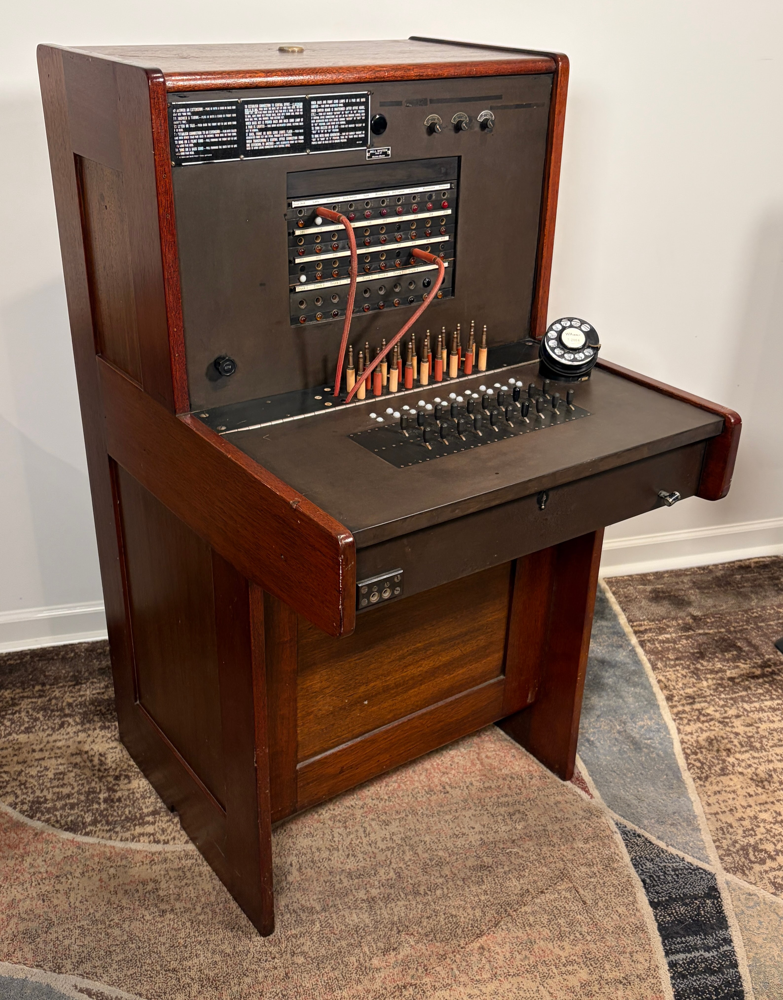

Many switchboards that show up on eBay are "gutless wonders" with the
relays and other circuitry that made them work torn out. (Tearing out
the guts made a switchboard much lighter.) Fortunately, Ms. Bell's
switchboard was essentially intact and operational.

  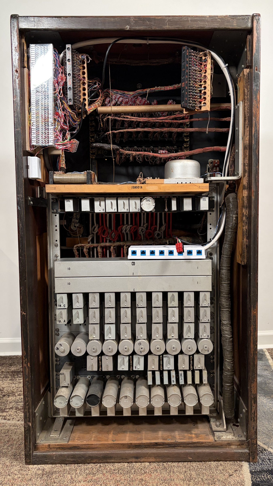

All it needed to work reliably
was to clean the jacks and cord plugs,
replace a few lamps, and replace a row of jacks that had failed.
(The last task entailed reconnecting forty-nine wires.)

<!-- pagebreak -->

### How the Switchboard Works

A switchboard must provide these functions:

- A person at a telephone must be able to *signal* the operator.
- The operator must be able to talk to the caller to determine whom
the person wants to call.
- The operator must be able to determine if the desired destination is
available, not busy on another call. (A destination is busy if a cord is plugged into its jack.)
- The operator must be able to connect to the desired destination.
- The operator must be able to alert the desired destination by
ringing its telephone.
- The operator must be able to *supervise* the call to know when the parties have hung up
in order to tear down the connection.

The photo below identifies the elements of a switchboard.

  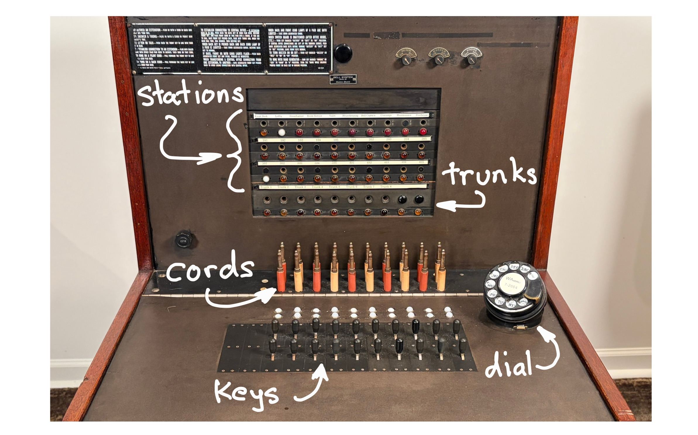

On the switchboard face are three rows of ten jacks. The jacks
connect to *stations*, the name for telephones in the building. A lamp below
each jack illuminates when a caller picks up a phone.

Below them, the ten jacks of a fourth row are *trunks*, used for making calls to
and receiving calls from outside. (The last two trunk jacks are
unused.) A lamp below each trunk jack illuminates when a call arrives
from outside.

Below the jacks are ten pairs of cords the operator uses to connect
calls. Each pair has a front and a rear cord.
She plugs one cord into a jack to answer an incoming call and
then plugs the other cord into the desired destination.
With ten cord pairs, the switchboard can handle at most ten calls at
once.
Lamps in front of the cords signal when the parties have hung up
and the operator should tear down the call by pulling the cords from the jacks.

Each cord pair has two *keys*, or switches, in front of it. The
operator pushes the front key away from her to connect
her headset, and pulls it to ring the station on the front cord. 
She pulls the rear key to ring the station on the rear cord.

The operator uses the dial to the right of the switches to place
outgoing calls. (Phones connected to the switchboard typically have no
dials of their own.)

Trunks to the outside world run to a *central office* in the city.
From the point of view of the central office, the switchboard looks
like eight telephones, each with its own line.

From the point of view of a station, the switchboard looks like a
central office, which can ring and connect calls to the station.

## The Game Hardware

Because the switchboard was intact, one of my design
goals was not to modify it in any way and to build the game hardware
to stand in for the telephones and outside trunks that would connect to
it.

The figure below is a block diagram of the game hardware.

  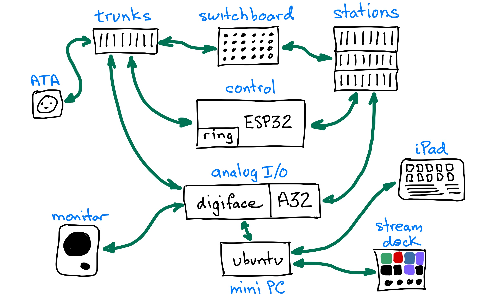

I designed and built the following items:

- A control board containing an Olimex ESP32-POE-ISO and a ring generator circuit.
- A board containing eight trunk circuits.
- Three boards each containing eight station circuits.

Other elements include:

- An Ubuntu [mini PC](https://www.geekompc.com/geekom-a5-mini-pc/) running the game software.
- A [Ferrofish A32 Pro](https://www.ferrofish.com/a32pro-converter-multimode)
32-channel analog converter, connected to the
PC via an [RME Digiface USB](https://rme-audio.de/digiface-usb.html) 4-port ADAT interface.
- A 24 V power supply, to power both the trunk and station boards and
the switchboard.
- A [Stream Deck+](https://www.elgato.com/us/en/p/stream-deck-plus), used to control the game.
- An iPad displaying a live view of the switchboard state.
- An audience monitor speaker.
- A [Grandstream HT801](https://www.grandstream.com/products/gateways-and-atas/analog-telephone-adaptors/product/ht801)
analog telephone adapter (ATA), which allows people to call the switchboard
from their mobile phones.

Everything is packaged in a 6U travel case.

  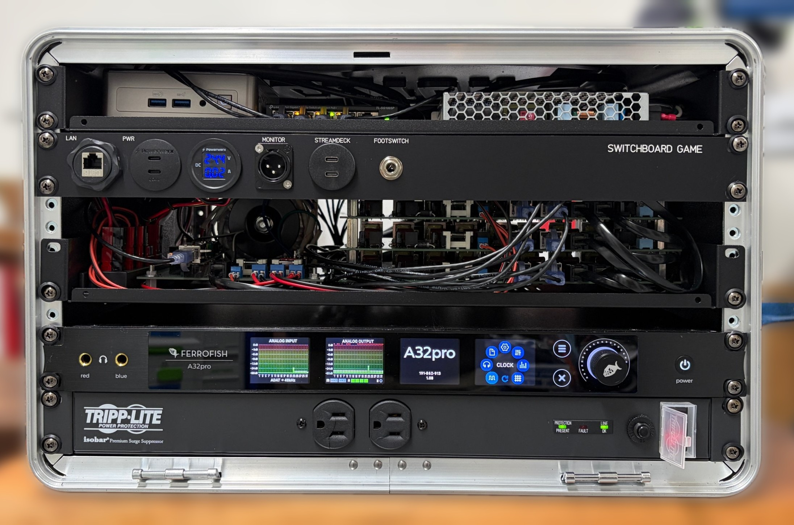
  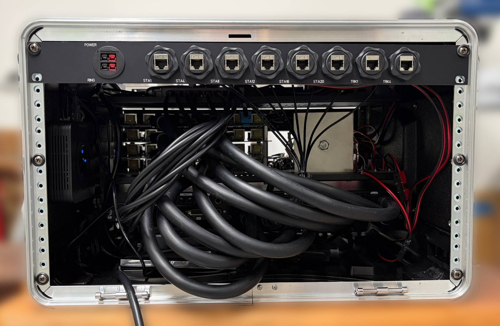

### The Control Board

An ESP32 on the control board controls and monitors the trunks and
stations via a daisy-chained I2C bus. I chose the Olimex part because
it can be powered via its Ethernet interface using PoE.
The ESP32's ground is tied to the 24 V supply that also powers
the switchboard. PoE keeps that ground isolated from the PC.
A small TP-Link 5-port switch connects the ESP32 to the PC and provides power.

  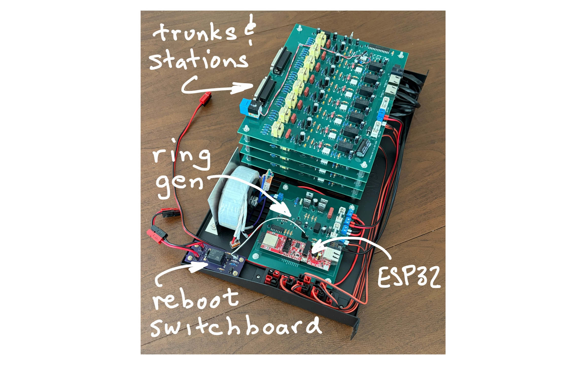

The board also generates ring voltage, used by the trunks to signal
the switchboard and also supplied to the switchboard so that it can
ring stations. Ring is nominally 90 volts RMS at 20 Hz.
Commercial ring
generators are available, but small ones typically don't generate
sufficient voltage to reliably trigger the switchboard trunk ring
detection relays. Also, I thought it would be enlightening to build my
own.

In my design, the ESP32 generates a PWM digital signal,
which controls a MOSFET H-bridge operating at 24 volts. The PWM
signal is a 40 kHz carrier whose duty cycle follows a 20 Hz sine.
The bridge drives a
mains transformer wired backwards to step the signal up to about 80 volts.
This was the best I could do with the available transformer, but it is high enough.
I stumbled a few times selecting a suitable transformer.
A doorbell transformer, the obvious first choice, would have
saturated, so I never connected it. The 70 V audio transformer I
tried next did saturate. When that happens its
inductance collapses and only the winding resistance limits the
current. Fortunately, my bench supply current limiter prevented the
MOSFETs from frying.

My third choice, an Antek toroidal mains transformer, didn't saturate,
but its first power-up put the 40 kHz
carrier on the output at over &plusmn;250 V peaks, until a 1 &micro;F capacitor
across the winding turned it into a sine. (Observant readers may discern this is the
first time I've built one of these things.)

If I do a rev 2, a better design
might be a more standard DC-to-AC inverter. These use a high-frequency
square wave to drive a much smaller step-up transformer. The output of
this transformer is rectified and filtered to provide DC at the desired peak voltage.
A second H-bridge uses PWM to generate the 20 Hz signal. But of course,
I'd be trading the big transformer for a much higher parts count.

#### Switchboard Reboot

The switchboard's trunk ring relays latch when they receive the first burst of ringing so that
the trunk lamp stays lit until the operator plugs a cord into the trunk jack.
After designing the control board I realized that a player could abandon the game and leave
a trunk lamp lit. So, I designed and added a small daughter board with a relay that the
ESP32 can operate to cycle power to the switchboard, effectively rebooting it.

### The Trunk Board

The circuit between a central office (CO) and a telephone (station) is a DC loop.
To the trunk board, the switchboard is the telephone: the board plays the central office.

  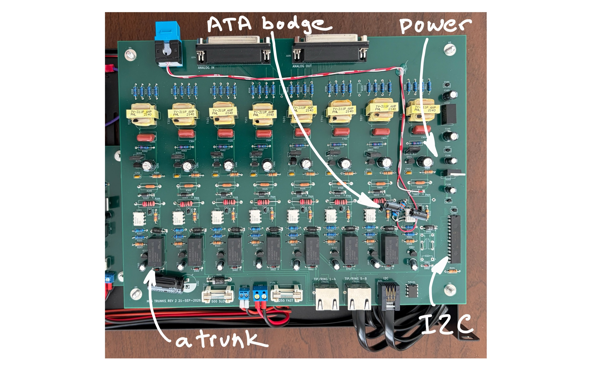

The CO powers the loop. When the phone is *onhook* (hung up) it presents an open
circuit to the CO. When a person picks up the phone it goes *offhook* and presents
a DC resistance. The analog audio signal rides on top of the DC.
(The phone's ringer, which is connected when the phone is onhook,
is in series with a capacitor so that the ringer passes the AC but no DC,
and the line still reads as open.)

By convention one wire of a telephone loop is called *tip* and the other is *ring*.
These names derive from the elements of a telephone plug: tip, ring and sleeve.
Sleeve is used on a switchboard for control.

The trunk board's eight circuits must do the following:

- Power the DC loop. A traditional CO feeds -48 V through a resistance;
I used a constant 30 mA current instead, as modern line cards do.
- Ring the station by temporarily applying the 80 V ring voltage to the loop.
- Detect when the station goes offhook and the loop is *seized*.
- Provide a path for the audio signal to and from the Ferrofish analog converter.

The schematic below shows one of the eight trunk circuits.

  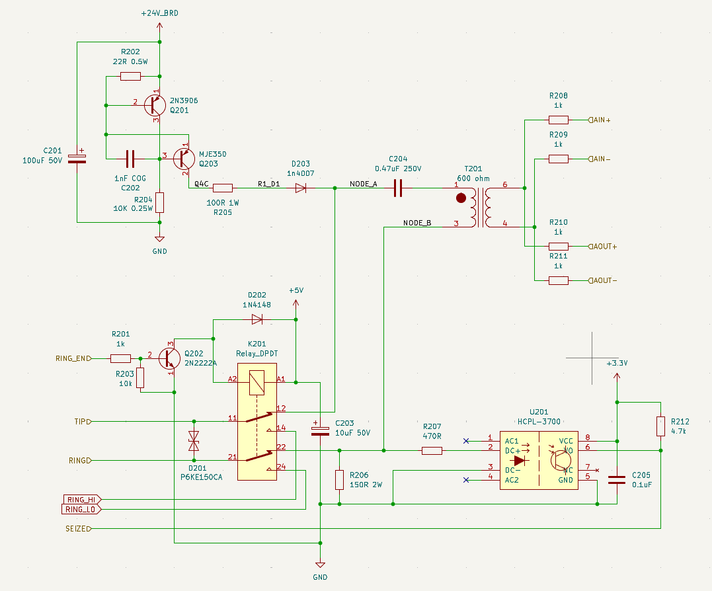

The two transistors and associated components in the upper left make up a 28 mA
constant-current source, which is close enough to the nominal 30 mA.

The AC-coupled 600 &Omega; transformer in the upper right connects the circuit to the
input and output for one of the 32 Ferrofish channels.

Tip and ring from the switchboard trunk connect to a relay in the lower left.
The relay normally connects the trunk to the current source and transformer.
To apply ring voltage to the trunk, the ESP32 briefly pulses the relay,
which sends 80 volts AC to the trunk.

Normally, a CO would send the standard
ring cadence of 2 seconds on, 4 seconds off. However, the trunk needs to detect
that the operator has plugged a cord into the trunk (and seized the trunk)
as soon as it happens, and the circuit cannot sense loop current while
its ring relay is on. Fortunately, the switchboard trunk ring relays latch
on the first burst of ring. So the ESP32 firmware is designed to send a
single burst. I found that a one-second burst is sufficient to cause
the switchboard relays to latch reliably.
(I could go on about how a CO applies ring on top of the
DC loop current...)

The optoisolator on the lower right completes the circuit. It detects that current
is flowing through the loop, indicating that the station (in our case, the switchboard)
is offhook.

A player will often accidentally pull a key to apply ring voltage from the switchboard
to the trunk. The trunk circuit is designed to survive the 80 volts.
The first design fed the trunk through a 330 &Omega; resistor, and a ring
key held by mistake would put 7 to 10 watts into a 1 W part. The
constant-current source fixes the problem, because it passes the same current
whether the line is idle, seized or being rung into.

The ESP32 controls and monitors all trunk circuits via an MCP23017 I2C I/O expander.
Each trunk has a control output to activate the ring relay and a sense input
to signal offhook.

The trunk loops are powered by 24 volts. The common section includes a 5 V regulator
to power the relays and a 3.3 V regulator for the I2C interface.

#### Debugging the Loop Detector

When testing the board, I found that the trunk failed to reliably detect loop current.
I debugged the problem
by connecting a station circuit to a trunk circuit and writing software to repeatedly
toggle the station between onhook and offhook. I used an Analog Discovery 3 logic analyzer
to record the optoisolator output. The software was able to use the AD3 API to read the
output and align it with the station toggles.
The test showed that the trunk missed up to 27 of 100 offhooks with full loop current flowing.
Measuring it, I found that the optoisolator's input sat at 3.28 V and 1.9 mA, inside its
hysteresis band. That's above the voltage at which it turns off but
below the one at which it turns on.  The output stayed wherever the
relay's contact bounce left it. I fixed the problem by adjusting the
values of the resistors in front of the optoisolator input.

### The Station Board

The station board is a mirror of the trunk board.

  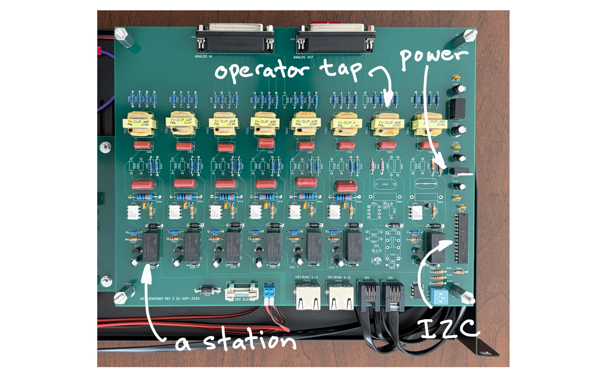

The station board's eight circuits must do the following:

- Detect ring from the CO (in our case, from the switchboard).
- Go offhook by presenting a DC load to the loop circuit.
- Provide a path for the audio signal to and from the Ferrofish analog converter.

The schematic below shows one of the eight station circuits.

  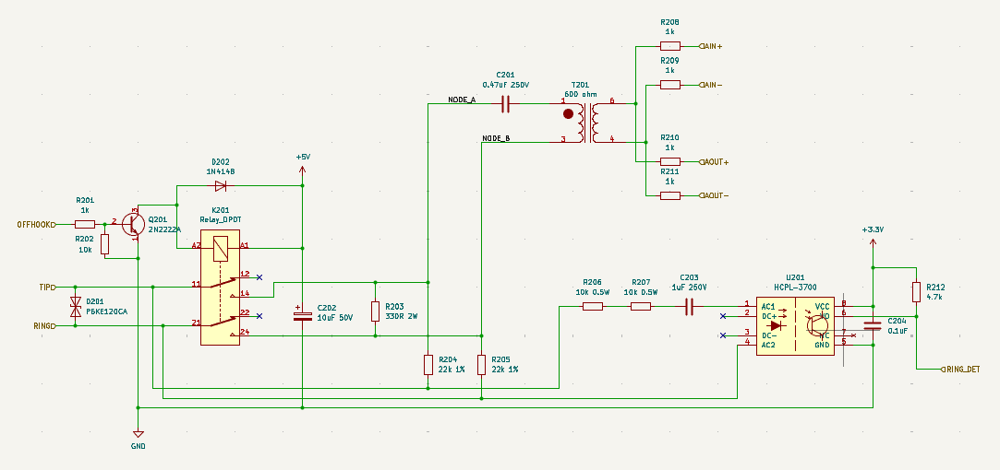

Tip and ring from the switchboard connect to the relay on the left. The relay is
normally open. To go offhook, the ESP32 turns the relay on, putting a 330 &Omega; resistor
across the circuit.

When the station is offhook, the AC-coupled 600 &Omega; transformer in
the upper right connects the circuit to the input and output for one
of the 32 Ferrofish channels.

The optoisolator in the lower right detects the ring signal. It sits ahead of the relay
so that it sees ring when the station is onhook.
A player will often accidentally ring an offhook station; the circuit components
are sized to survive the 80 volts. The first line of protection is a TVS
diode across tip and ring.

There are three station boards. On the third board, one circuit is a tap on
the operator's headset, and includes only the transformer section. I'll explain
the purpose of the tap later. A second circuit on the same board is configured
to work with a real telephone connected to the switchboard. This allows people
watching the game to pick up a phone and talk to the operator. The special
telephone circuit simply omits the loop load resistor. (More on this later.)
With these two circuits
used for other purposes, there are twenty-two game stations. I distributed
the twenty-two stations and the real telephone across the thirty switchboard jacks, leaving seven unused.
In theory I could have added a fourth station board, but the real limiting
factor is the thirty-two Ferrofish channels.

The ESP32 controls and monitors all station circuits via an MCP23017 I2C I/O expander.
Each station has a control output to activate the offhook relay and a sense input
to signal ring detected.

The board is powered by 24 volts. The common section includes a 5 V regulator
to power the relays and a 3.3 V regulator for the I2C interface.

## The Game Software

First, I'll address the question many readers will have. Did I use
AI to develop this game? The simple answer is an unreserved yes. I started
by using Claude as a sounding board for hardware design questions, and I found it quite useful.
When I was about to start writing the ESP32 firmware I asked it about my design ideas.
It surprised me by presenting a framework for working code.
Given the amount of code to be written and the short timeline
I had set for the project, I simply threw up my hands and told Claude to write it all.

So, the division of labor has become this: I designed the hardware, drew the schematics,
laid out the PCBs and assembled the boards. I set the requirements and reviewed the specifications;
Claude Code wrote most of the code
and, equally important, maintained the specifications. Claude is a much better
note-taker than I. Every step of the process, every design decision, every misstep,
every bug, every hardware test, everything, is documented. After five weeks of
development, the game's
[specification](docs/game_control.md) is at its 100th revision.
When there were problems that spanned hardware and software, I was able to work
with Claude to devise tests incorporating the Analog Discovery 3, game logs,
and one-off test programs, which turned out to be far more useful than the debugging tools
I'd built into the iPad display.

I'm also thrilled to be able to work on the project anywhere I have my iPhone or
iPad. I woke up at 4 a.m. recently and 
got to wondering how often players ring the wrong cord.
Lying in bed, I described the problem.
Claude confirmed from the logs that, indeed, a player (likely me!) had rung
the wrong cord into a trunk twenty times in the past week.
We then quickly devised a way for the game to detect the error and have the 
tutor explain what to do. Then I fell back asleep.

But my intern isn't infallible. It sometimes states things confidently that
turn out to be wrong. Usually the errors are obvious,
but sometimes I need to futz at the bench or force it to review logs
to settle matters. Of course, it also can't see or touch the switchboard,
so every hardware fact has to come from me or the test equipment.
Occasionally I need to remind myself that I'm not becoming my intern's intern.

### Software Overview

The figure below is a block diagram of the game software.

  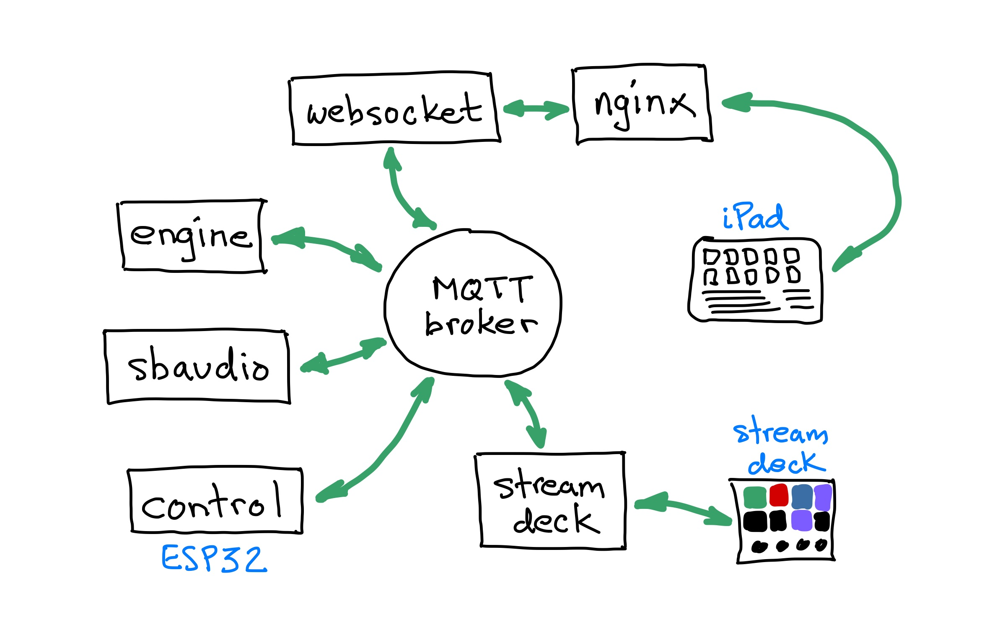

### MQTT and Mosquitto

I have used MQTT for many home automation projects, and early on decided
the protocol would be a great way to tie all of the software elements
together. This was a fortuitous decision because it allowed me to more easily add
functions over time. For example, when I thought of using the Stream Deck
to control the game it was easy to add a new software module to control it,
hooked to everything else via MQTT messages.

MQTT messages are handled by a Mosquitto broker running on the PC. All
of the software modules, including the ESP32, communicate via connections
to the broker.

MQTT also makes it easier to debug. With `mosquitto_sub` I can see the whole
game live. A debugging daemon, `sbgame-mqttlog`, records every message. When
something doesn't seem right, I can note the time and describe the problem to
Claude, which can then scour the logs. Usually it finds the problem in a few seconds
and starts working on a fix.

### Who's on First

When I began designing the game, I needed to solve a problem:
how would the game know which trunk and station channels are connected to
each other by cord pairs and which channels the operator
is keyed to. Without this knowledge the game wouldn't be able to
monitor and progress through play.

The solution I came up with is to have pilot tones constantly play on all
channels, including on a tap on the operator headset, and to run an
FFT on every channel. When a cord connects two lines, each one hears
the other's tone and reports which line it's patched
to. The operator tap plays a 9 kHz pilot tone. When other channels
hear the tone, they know the operator is keyed in.
The tap also feeds the operator's voice to the audience loudspeaker when no call is in play.

The pilot tone scheme made the game possible
while maintaining my prime directive: not modifying the switchboard.
A nice side benefit is that each channel can report an error when
it cannot hear its own tone, as a `deaf` message. When a channel
hears more than one tone, it reports `ambiguous`, which means
a cord fault or crosstalk.

The pilot tones start at 6 kHz, above the nominal 3.4 kHz telephone
audio band, and go up to about 9 kHz. The frequencies are calibrated
to fall in the middle of the FFT bins.
A 4096-point FFT at 48 kHz gives 11.72 Hz bins. The tones are spaced
8 bins (about 94 Hz) apart.
The `sbaudio` program, described
later, generates the tones, runs the FFTs, and reports the results via
MQTT.

The pilot tone decision also determined the audio hardware. At first
I considered using a bank of telephony FXS (trunk) and FXO (station)
cards, perhaps connected to an Asterisk telephone system. But the requirement
that the hardware be able to hear tones up to 9 kHz made telephony
interfaces unusable. In the end the Ferrofish and my own hardware
turned out to be a good solution.

The Ferrofish also provides a very compact
hardware interface for 32 input and 32 output channels. It uses eight DB25 connectors.
Cables connect the signals directly to pairs of DB25 connectors on the trunk and station
boards.

The operator headset frequency response rolls off above the telephone band,
but players who are young enough can still hear the pilot tones. To eliminate them,
I added a low-pass filter in the headset receiver path.
I used a fourth-order passive elliptic (Cauer) LC filter,
which places two notches inside the 6-9 kHz pilot band.

### The ESP32 Firmware

The ESP32 firmware is written in C++. It supports OTA updates over the LAN.

These are the functions performed by the firmware:

- Monitor and control the trunks and stations via I2C.
- Generate the ring PWM signals that drive the H-bridge. The firmware
outputs two digital signals,
one for each half of the bridge, one pulsed during positive half-cycles and the other during negative.
A transformer driven from a zero crossing swings to nearly twice its normal
flux on the first half-cycle, enough to saturate this core, so the
firmware starts at a peak.
- Detect and report dial pulses on the trunks. The software is tolerant
of expected variations in dial pulse widths and distinguishes between
dial pulses and seizure releases.
- Perform failsafes. If the ESP32 ever loses the game engine MQTT
heartbeat it immediately releases every control relay on its own.
- Control the switchboard power reboot circuit.
- Manage ring guards: No trunk is allowed to ring for more than 30 seconds;
at most four trunks are allowed to ring at once, to leave headroom for the
operator's own ringing; and trunk seizure is ignored while a trunk is
ringing, because ring energy looks like a seizure.

### The `sbaudio` Program

The `sbaudio` program runs on the PC and is written in C++. It performs
all of the game's audio processing:

- Generate and detect pilot tones.
- Play pre-recorded WAV files, for all the things the game characters say.
- Listen for and report speech by the operator. (It's a simple speech
detector. Maybe we can do speech recognition in version 2.)
- Send audio to the audience monitor speaker. The hardware plays the
audio through the Digiface's headphones output, saving a channel on the
Ferrofish. 
The loudspeaker follows the call the operator last answered, playing what's heard on the caller's line.
The output is low-pass
filtered to remove the channel pilot tones.
- Provide functions to record the monitor audio and to play back
recorded sessions. Buttons on the iPad control this feature.
- Listen for and detect speech on other channels. I added this
capability to support calls from real people on the local telephone
or via the dial-in number. Because people tend to talk
over recorded speech, this feature required adding an adaptive echo
cancellation filter so that the software could detect speech while
playing a recorded utterance.
- Play telephone company tones on command: dial tone, ringback,
plain busy and fast busy, played on the trunks as the operator dials out. These
are the Bell System tones of the 1950s, not the modern ones.
The ringback is rebuilt from a recording of a real 803C tone alternator,
because my museum friends insisted.
- Check its own output. When the Ferrofish's meters started showing
bursts of noise, I added a check that compares every sample `sbaudio`
sends with what it should be. The check found nothing wrong while the
meters went wild, so the problem was downstream. It turned out to be
the Digiface, and switching it to class-compliant mode fixed it.

### The Stream Deck

  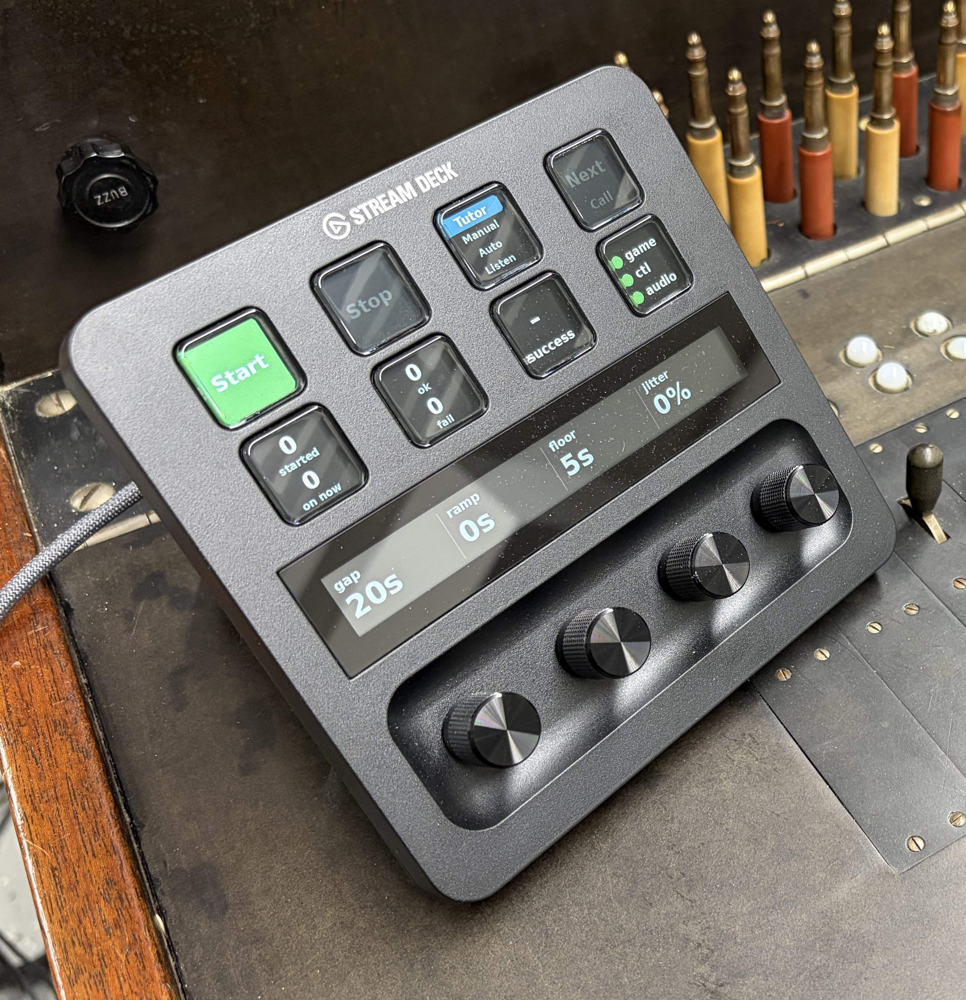

A Stream Deck+ sits on the switchboard and provides buttons for controlling
the game and checking the state of play. The `sbgame-streamdeck` program controls
the deck. The program talks to the game only through MQTT. If the game program crashes, the deck stays up and shows the game as offline.

The program talks to the deck through the open-source `streamdeck` Python library over USB. It draws each key's image itself with the Pillow imaging library.

A key press changes nothing on the deck by itself. The press publishes an MQTT command,
and the key only changes when the game's state topic echoes the change. The deck therefore can't show something the game hasn't done.
There are two exceptions to that rule: *Stop* lights up armed and waits for a second press, and *Next Call* goes dark briefly so it can't be double-pressed.

Dials at the bottom of the deck control the call rate for automatic mode:

| Dial | Sets |
|---|---|
| 1 | **gap**: the starting wait between calls |
| 2 | **ramp**: how much the gap shrinks per connected call |
| 3 | **floor**: the shortest the gap can get |
| 4 | **jitter**: random spread around the gap |

Here's how the next call is timed in automatic mode:

- The clock starts when the latest call is connected or ends, whichever comes first. *Connected* means the operator's work is done,
for example when a called room answers.
The logic means that only one call is ever waiting for the operator. Calls do overlap,
but the game never asks the player to handle two calls at once.
- The gap shrinks as the game progresses: `gap_now = max(floor, gap - ramp x connected_calls)`.
With ramp 0, the rate is constant.
- Jitter makes the timing feel less mechanical. The actual wait is drawn evenly from `gap_now` +/- `jitter` percent.

### The iPad Display

  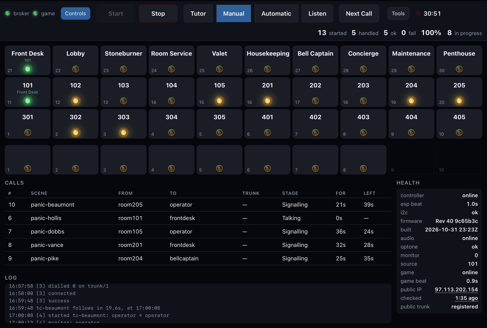

In addition to the Stream Deck, I decided to add an iPad display late in the game.
The Mosquitto MQTT broker made the addition remarkably simple. Mosquitto has a WebSockets
interface that allows a web client to receive and send MQTT messages.
JavaScript on the client processes the messages and manages the display.

An nginx web server running on the PC serves static content and proxies the Mosquitto WebSockets channel.
It hosts the website at `game.kr3am.org` (my ham call sign) using a proper Let's Encrypt certificate,
because web clients kinda insist on it. Of
course, certbot renews it automatically, proving ownership through DNS, so the PC never has to be exposed to the internet.

The iPad displays a replica of the switchboard jacks, showing their status, along with a list of queued
calls, a log of game events, a game health panel, and buttons for controlling the game that duplicate
the Stream Deck buttons. The display provides these functions:

- Tapping a jack displays detailed status information and provides various debugging tools.
- By long-pressing the *Next Call* button you can choose which scene to play next.
- The *Tools* button opens commands for diagnosing the operator
channel, sweeping the trunks and stations for basic connectivity,
recording the monitor audio and playing back recordings, and turning
the switchboard power on and off.

### The Game Engine

The game engine, written in Python, runs the game. A single file, `script.yml`, completely specifies the game: the list
of characters, details about each scene (who says what when), which jack each trunk and station is wired to,
and more. The same file also drives the speech rendering, so adding a scene or a character needs no code changes.

There's a lot of complexity under the hood; here are a few of the more interesting parts:

- The engine shuffles scenes like cards, so every scene plays once
before any repeats, and a scene is skipped if one of its people or
lines is already busy in another call.
- Some scenes follow another scene, such as Hale's pizza order three
minutes after he found a line busy, or a trace after a suspicious
call. The follow-up only happens if the operator connected the first
call. The hotel-wide panic about Martha the dog is the extreme case: a chain of calls that
start almost together.
- The tutor watches the same board signals the game does. She
stops mid-word once the player has done what she asked, repeats herself
after 20 seconds, and switches to short prompts once the player has heard the full
version twice.
- The pilot tones tell the engine which jacks are connected,
and the speech detector tells it when the operator speaks.
A call succeeds when the right parties end up talking, and fails on a timeout or a cut-off.

Before I'd even gotten the PCBs back from China, I needed a way to test the engine.
The `run-sim` program stands in for the ESP32 and `sbaudio`, and with `-o` it even plays
the operator, answering and connecting calls. The whole game runs,
iPad and Stream Deck included, without a switchboard.

### Generating the Speech

The Hotel Ballard acting troupe has 60 players who say 1717 pre-recorded utterances.
The software generates the speech using Qwen3-TTS, Alibaba's open-weights speech model.
Since I don't have sufficient processing power at home, I run it on an AWS instance in the cloud.
The instance is g6.xlarge, with one NVIDIA L4 GPU with 24 GB, 4 vCPUs and 16 GB of RAM.

The file `script.yml` contains specifications for the players and what they say.
Each player specification describes the desired type of voice: sex, accent, and other
characteristics. The software uses the description and a sample of text the player
will speak to have the Qwen3 VoiceDesign model invent a voice and generate three samples.
I audition the samples and choose
the one I prefer. That sample becomes a reference clip.
Next, the software uses the Qwen3 Base model to clone each voice and render all of the utterances.

The software downloads and stores the speech as WAV files.
It then filters the speech to the telephone band, 300-3400 Hz,
to make the studio-quality recordings sound more like they're on a 1950s phone line.
The low-pass filter also keeps the speech clear of the 6-9 kHz pilot tones.

The file `tts/pronounce.yml` fixes Qwen3 pronunciation mistakes by respelling words.
For example, the model reads "401" as "four hundred one," but a 1950s guest says "four oh one."

The tutor is a special case. For that voice I wanted the sound of an experienced operator.
Serendipitously, the Connections Museum recently posted an old Bell System film,
[*Operating Technique: "A" Board Toll Tickets*](https://youtu.be/H8G4E1qmFdo).
The film is in the public domain, and the narrator has the perfect voice. So, I captured audio
from the film, transcribed it, and made that the tutor's reference clip in place
of a designed voice.

As I modify the game and tweak utterances, the software can spin up the instance
to render only the changes.

The AWS instance costs about $1 an hour to run, but the software ensures that it runs only long enough
to do the work. Traps in the software kill the instance, and there is a 4-hour self-destruct.

### Handling Player Mistakes

As friends and I play with the game, I've noticed common mistakes.
I modified the software to detect them and nudge the player in the right direction.
Here are a few of those mistakes and how the software handles them:

- *Ringing the wrong room*. During a scene the game knows which room the operator should call.
If it detects ring on the wrong room, the room's usual occupant answers and says, "Hello?
Is anybody there?" Using pilot tones, the game also knows whether the caller is patched to that room.
If so, the caller says, "Operator, that's not who I asked for." The wrong room
hangs up and the player can still recover by connecting to the right room.

- *Ringing a trunk*. On the switchboard, only front cords will work with trunks. Standard practice is to answer
calls from stations with a rear cord so the front cord is available in case the caller
wants to place an outside call on a trunk. This means that the operator will usually
end up using the front cord for calls to local stations, and players get used to
ringing with the front key. When an outside call arrives on a trunk the operator
will use the rear cord to connect to the desired station. In this case the operator
must use the rear key to ring the station, but habit causes players to accidentally
use the front key.

  The game detects when the player rings a trunk and has the tutor jump
  in to offer helpful advice, even when she's not otherwise tutoring.
  The ESP32 firmware detects the trunk ring
  using the loop (seizure) detector circuit. The 80 V ring signal makes
  the detector chatter, nearly the same way dial pulses do. But dial pulses
  are about 100 ms apart, and the breaks from 20 Hz ring come 60 ms apart or less.
  The firmware distinguishes between the two and reports ring as a `ring_on_trunk` fault.

- *Ringing the caller*. On a station-to-station call, the game also detects when the operator
uses the wrong key to ring the caller rather than the station being called. Here again
the tutor explains the mistake.

  The caller station's ring detector cannot detect the incorrect ring because when
  the station is offhook its 330 &Omega; load pulls the 80 V ring down to about
  17 V, below the optoisolator's turn-on threshold. But the ring still reaches
  the station's audio channel, so the `sbaudio` program listens for it.
  The audio ring detector is a pair of Goertzel detectors, each a single-bin DFT.

  The primary 20 Hz detector works on 100 ms blocks of 4800 samples at 48 kHz, which is
  exactly 2 cycles of 20 Hz. DC and 60 Hz hum fall on the detector's nulls. A Hann
  window prevents the station's own outgoing speech from leaking into the 20 Hz bin.

  A secondary detector at 40 Hz rejects clicks caused by cord plugging.
  The 40 Hz level must be at least 20 dB below the 20 Hz level. The ring
  generator's sine has almost no second harmonic, but a plug's
  click or a contact bouncing spreads energy across the whole low band, so a click fails
  the test.

- *Plugging a rear cord into a trunk*. Rear cords always look like trunks, providing
loop current to stations. But front cords are ambidextrous. When plugged into
a station jack they are trunks, and when plugged into trunk jacks they are stations.
(The switchboard pulls this off by putting ground on station jack sleeves and
24 volts on trunk jack sleeves. The 24 volts cause the cord to trigger a *trunk relay*
that flips the mode of the cord.)

  The game detects when the operator accidentally plugs a rear cord into a trunk
  and causes the tutor to jump in once again. The game detects the error by
  noticing that two conditions that should always be true together aren't.
  When a front cord is plugged into a trunk and the operator headset is keyed,
  the trunk board reports the seizure and `sbaudio` hears the operator's pilot
  tone on the trunk's audio channel.
  On the other hand, if the operator uses a rear cord,
  the trunk will not be seized but `sbaudio` will hear the pilot tone.
  Only a rear cord produces that combination, so the tutor tells the player to use the front cord instead.
  The game has no direct access to the cords; instead it deduces which end is in the jack.

### Real Phone Lines

When I demoed the game to friends at the Connections Museum, we agreed that it would
be neat to have a real telephone connected to the switchboard. That way, people
watching someone play operator could pick up the phone and pretend to be a hotel guest.
As one can imagine, this idea led to significant feature creep. Next we decided
it would be even cooler if folks could call the switchboard from their mobile
phones via one of the switchboard trunks. Sarah Autumn, the museum's Chief Engineer,
configured a public phone number for the switchboard on her Asterisk server, and I
added a Grandstream analog telephone adapter (ATA) to the game.

I connected the telephone to a station jack and modified a station channel
to work with it:

- I removed the 330 &Omega; load resistor, because the telephone provides the load.
- I turned the ring detector into a hook detector.
- I kept the analog connection to the A32 and the offhook relay, so that the audio
channel is connected only when the real phone is offhook.

With this configuration, the game can detect when someone
picks up the phone and can hear the person speaking.
The pilot tones are also quite audible in the telephone's earpiece.
I fixed that problem by stashing the same low-pass filter
used for the operator headset inside the phone. The photo below
shows the filter in the phone.
The unpopulated section is an electret microphone circuit for the operator headset,
which I ended up not needing.

  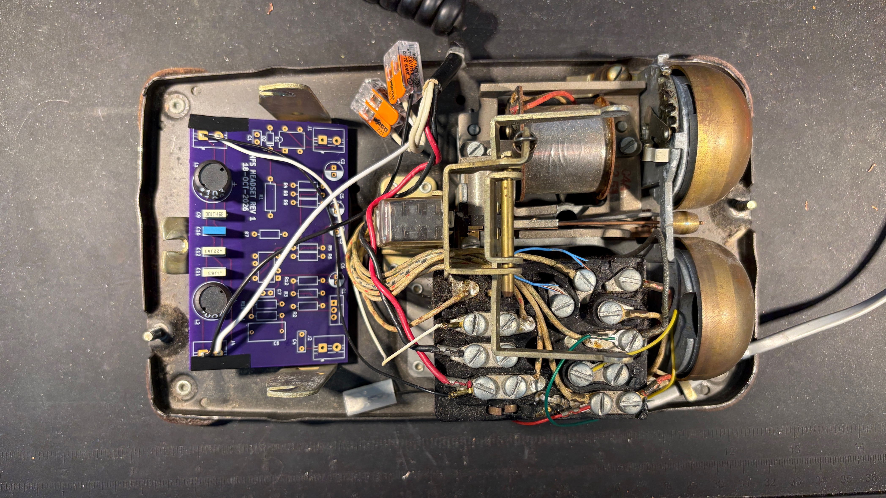

I connected the ATA to trunk 8 and modified a trunk channel to work with
it:

- I removed the constant current source, because the ATA provides loop current.
- I removed the ring relay; the ATA rings the line.
- I rewired the loop detector to its AC input, so the loop floats and the ATA's
polarity doesn't matter, and raised its resistor to 330 &Omega; for the ATA's 30 mA.
- I kept the analog connection to the A32.

After testing, I found that the trunk circuit required one tweak.
Even at its maximum ring voltage, 55 V RMS, the ATA couldn't trip the switchboard's trunk ring relay
because the loop detector's resistor took too much of the voltage.
The fix was to put back-to-back 220 &micro;F electrolytic capacitors
across the resistor to shunt it for AC ring.
With that change,
the game can't see the ATA's ring at all. It first learns of an outside call when the operator answers.

Now that other people can call the switchboard, we had to figure out something for them to do.
Sarah suggested having Lenny stay at the hotel.
Lenny is a famous telephone chatbot, sixteen recordings played one at a time whenever the caller pauses.
Lenny's responses are odd, confused,
and off-the-wall, but they are convincing enough that some telemarketers have
tried to engage with him for an hour or more.

The operator can connect a human caller to any of the local stations and can also dial out
to any of the businesses configured in the game. That's 37 characters who could answer. So,
I configured every character to make Lenny-like responses when connected to a person. The
characters say different things, based on their own personalities and back stories.
There are a total of 367 utterances. You can also talk to Lenny himself, if the operator
dials an outside number not in the game's list.

*Number, please?*

<!-- pagebreak -->

## Afterword

### Thank You

Without the generosity and encouragement of these people, I'd still be thinking I might do this project someday.

Peter Amstein has enthusiastically supported the project. He arranged for me to have
a switchboard to play with, and he drove it all the way to Santa Cruz for its
first appearance at a conference.

Sarah Autumn suggested adding Lenny mode. She set up a public phone number
to allow people to call the switchboard from their own phones and chat with
hotel guests. Whatever cable, plug, lamp or jack I needed, she had.

David Dintenfass built the bracket for the ginormous ring transformer and
meticulously cleaned the switchboard plugs and jacks.

Jonathan Balik was the talent in the YouTube video; he made it fun to watch.

Eric Rhinelander and Remco Enthoven cheered me on throughout.

Beth Holmgren, my spouse, was the first player and my moral support.
She suggested that Martha the dog be a hotel guest and reminded me of, hey, you
remind me of a man. She also edited this document; any errors that remain are mine.

### License

The code and documents here are under the [MIT License](LICENSE), with two exceptions.

MQTT.js, in `engine/web/mqtt.min.js`, has its own MIT license,
[copied beside it](engine/web/mqtt.LICENSE.md).

The Lenny recordings are not in this repository. They circulate freely on the internet, but
no one seems able to say who holds the rights, so I can't pass on a license for them. To
hear Lenny, download [Lenny.zip](https://crosstalksolutions.com/pub/Lenny.zip) and process
the files as `tts/recorded/PERFORMERS.md` describes. Without them, the rest of the game
is unaffected except that the operator's call to an unknown number has no one to answer it.
